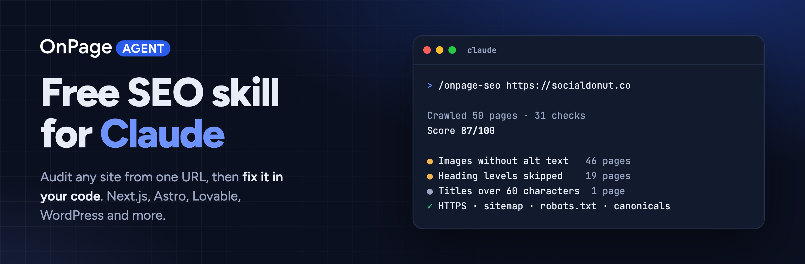
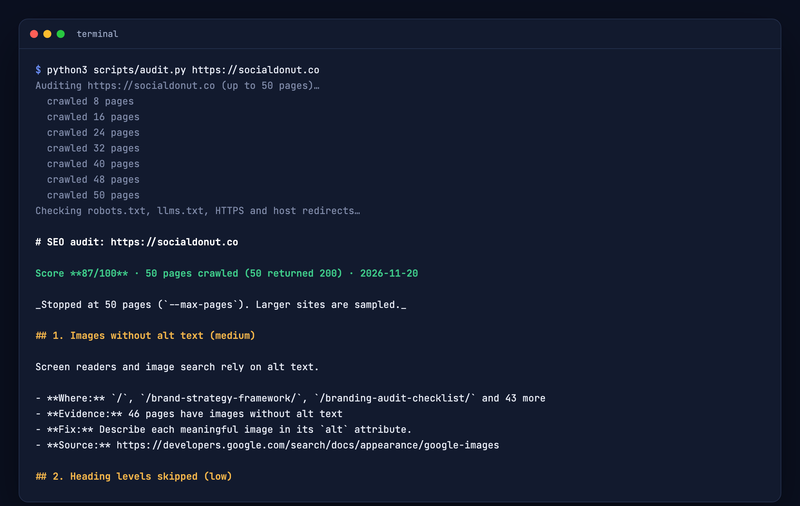
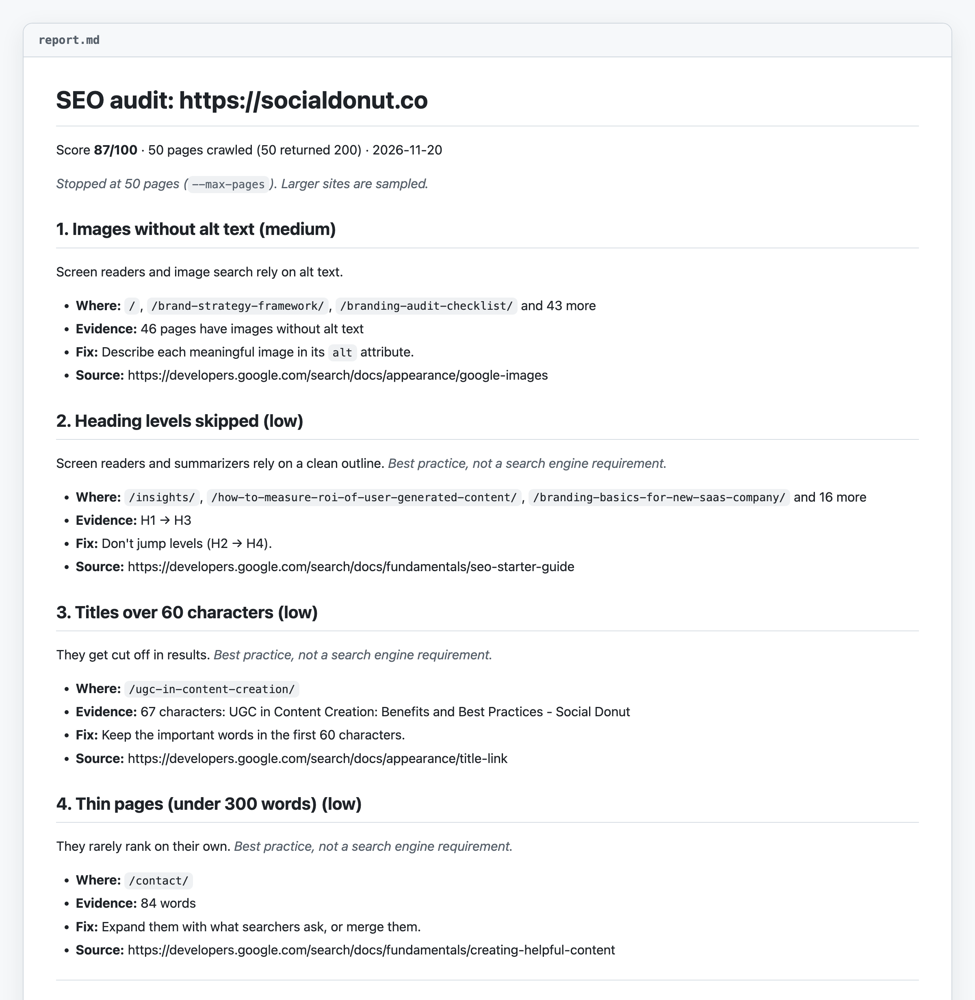

<p align="center"></p>

<p align="center">
  <a href="https://github.com/OnPage-Agent/onpage-seo/actions/workflows/tests.yml"></a>
  <a href="LICENSE"></a>
  
  
  
</p>

# OnPage SEO: a free SEO skill for Claude

Audit any website's on-page SEO from one URL, then have Claude **fix it in your code**:
Next.js, Astro, React/Vite (Lovable, Bolt, v0), Nuxt, SvelteKit or plain HTML. On WordPress,
Webflow, Wix, Shopify or Squarespace it gives you the exact clicks instead. It also sets up Google
Search Console, Google Analytics 4 and Bing, and turns your keywords into article ideas and briefs.

Free and open source (MIT). No API keys, no accounts, no installs beyond Python 3.10+.

```
/onpage-seo https://example.com
```

## What it checks

31 checks on the live site, each tied to Google's documentation, ranked by impact:

| Area | Checks |
| --- | --- |
| Crawling and indexing | robots.txt blocking search engines, noindex, pages returning errors, redirect chains, missing or broken canonicals, no sitemap, soft 404s, www and non-www both serving |
| JavaScript | pages whose content only appears after JavaScript runs (the usual Lovable/Bolt/SPA problem) |
| On the page | missing, long or duplicate titles; missing or duplicate meta descriptions; missing or multiple H1s; skipped heading levels; thin pages; duplicate text |
| Mobile and markup | no viewport tag, no `lang`, structured data that doesn't parse, no Open Graph tags, no favicon |
| Links and images | images without alt text, links with "click here" text |
| AI search | AI crawlers blocked in robots.txt, no llms.txt (both marked optional) |
| Security | HTTP not redirecting to HTTPS, missing security headers |

Checks that are editorial conventions rather than search engine requirements are labelled
"best practice", so you know what actually matters.

## See it

A real run on [socialdonut.co](https://socialdonut.co) (50 pages):

<p align="center"></p>

Every finding comes with where it is, the evidence, the fix and the Google documentation behind it:

<p align="center"></p>

Full reports: [socialdonut.co](examples/socialdonut.co.md) · [onpageagent.com](examples/onpageagent.com.md).
Claude then reads the report, double-checks the top findings and fixes them in your code.

## Install

**Claude Code** (one line):

```bash
git clone https://github.com/OnPage-Agent/onpage-seo.git ~/.claude/skills/onpage-seo
```

Then, in any project: `/onpage-seo https://yoursite.com`, or just ask "audit my site's SEO".

**Claude.ai (web and desktop):** download this repository as a ZIP and upload it under
Settings → Capabilities → Skills.

**Without Claude:** the audit runs on its own:

```bash
python3 scripts/audit.py https://example.com --json results.json
```

## What you can ask

- "Audit https://mysite.com and fix what you can in this repo"
- "Why isn't my Lovable site showing up on Google?"
- "Add a sitemap, robots.txt and Open Graph tags"
- "Set up Search Console and Google Analytics for this site"
- "Here are 30 keywords from Search Console, turn them into article ideas"

## How it works

- `scripts/audit.py` crawls up to 50 pages (configurable) from your homepage and sitemap, four
  at a time, honouring robots.txt. It only talks to your site, refuses private and local
  addresses unless you pass `--allow-local`, and writes a Markdown report (plus JSON if you ask).
- `SKILL.md` tells Claude how to read the report, double-check the top findings, and fix them.
- `references/` holds where SEO lives in each framework and platform, the setup steps for
  Google and Bing, and the method for article ideas.

It doesn't invent numbers: no made-up search volumes, traffic estimates or "authority scores".

## Free skill vs OnPage Agent

| | This skill | [OnPage Agent](https://onpageagent.com) |
| --- | --- | --- |
| Audit any site, on demand | ✅ | ✅ every day |
| Fix code in your repo | ✅ with Claude | — |
| Fix WordPress automatically, with rollback | steps only | ✅ plugin |
| Real Google data (Search Console, rankings, AI Overviews) | — | ✅ |
| Search volumes, competitors, keyword gaps | — | ✅ |
| Shows whether each change worked | — | ✅ |
| Articles and landing pages written and published | — | ✅ |

## Tests

```bash
python3 -m unittest discover -s tests -v
```

They run against a small local site, with no network access.

## License

MIT. Made by [OnPage Agent](https://onpageagent.com).
